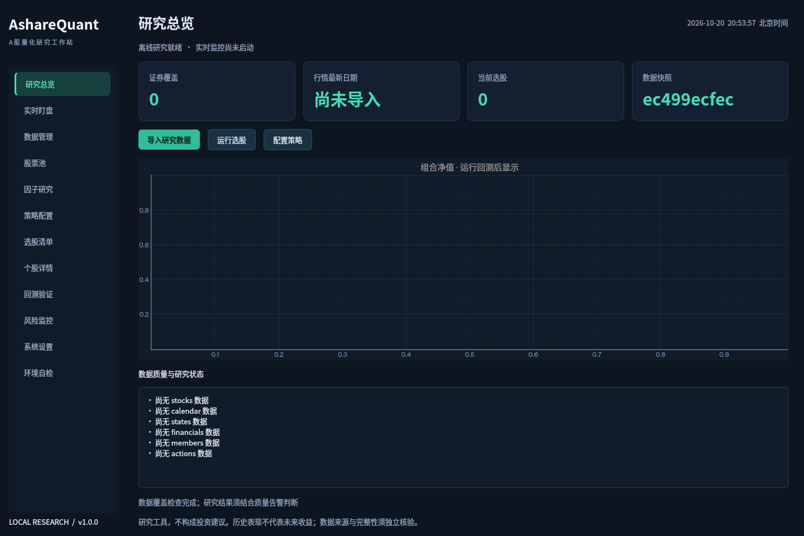

# AshareQuant

[下载源码 ZIP](https://github.com/FlyingGian/-/archive/refs/heads/main.zip) · [正式版本与离线依赖](https://github.com/FlyingGian/-/releases) · [构建状态](https://github.com/FlyingGian/-/actions)

源码 ZIP 解压后，安装64位Python 3.12/3.13，双击 `start.bat`；首次联网自动安装依赖。离线包由Release工作流生成，是否已就绪以Releases页面为准。

本地 A 股量化研究工作站，Python 3.12/3.13（64位）+ PySide6。包含46个内置因子、时点数据选股、保守日频撮合、组合风险预算、实时双源监控及可复现报告。



## Windows启动

1. 安装 [CPython 3.12或3.13的64位版本](https://www.python.org/downloads/windows/)，勾选 `Add python.exe to PATH`，建议同时安装Python Launcher。
2. 将源码包完整解压到有写入权限的本地目录，例如 `D:\AshareQuant`。不要直接从压缩包运行。
3. 双击 `start.bat`。首次自动建隔离环境并安装锁定依赖，之后跳过安装；默认用pythonw启动桌面。

无需手工运行pip。安装进度与错误见 `logs/bootstrap.log`；排障双击启动时可用 `start.bat --debug`，修复依赖用 `start.bat --repair`。

离线电脑：将配套 `AshareQuant-Windows-Wheels.zip` 中的 `wheels` 文件夹放入源码根目录，再双击 `start.bat`，自动优先离线安装。也可运行 `start.bat --offline` 强制离线。wheel包兼容CPython3.12/3.13 x64，不支持32位、ARM或3.14。

## 15分钟完成第一次研究

首次向导选择数据源、资金和股票池。产品首次启动为空数据库，没有预装虚构收益。

在“数据管理”导出9张空白CSV模板。按[数据字典](docs/02_data_dictionary.md)准备数据，文件名决定表名，批量导入。至少需要 `stocks.csv`、`calendar.csv`、`daily.csv`、`states.csv`；估值和财务因子还需要 `valuations.csv`、`financials.csv`；除权事件需要 `actions.csv`；指数股票池需要 `members.csv` 历史区间；基准对比使用 `benchmarks.csv`。

金额元、成交量股、比例小数。日期YYYY-MM-DD，代码六位。`daily`存原始价格与累计后复权因子；`states`存按日ST/行业/退市整理标记。证券级 `limit_up/limit_down` 推荐随日线导入。**规则核验范围以configs/rules.yaml为准：超过已核验范围时，严格撮合要求实际上下限，不猜测最新规则。** 若证券无价格限制，需先单独核验适用制度并更新规则，不能随便填0冒充价格。

“股票池”设置流动性与上市交易日过滤；“策略配置”选择因子权重；“选股清单”运行指定收盘日的选股。默认权重包含估值/财务，缺数据时不会凭空产生得分。只有量价数据时可以选用 `momentum_20`、`reversal_5` 等量价因子，并相应检查中性化市值数据是否齐全。

“回测验证”指定日期后运行，查看持仓、成交、拒单、成本0/1/2/3倍以及持仓数±20%敏感度。信号次日执行，开盘涨停拒买、跌停拒卖、停牌沿用前估值。导出完整报告获得HTML、PDF、PNG、Excel与参数/数据哈希。

“实时盯盘”可选择已导入基础信息的全市场或当前清单。日历覆盖正确才能自动监控，盘外用“单次快照”。超过15秒停止新信号；停止任务时先归档再退出。回放使用“选股清单”的日期。真实源需用户网络实测，免费源不保证服务质量。

“环境自检”检查版本、依赖、目录、磁盘与行情源。“系统设置”保存费率和Token，Token进入操作系统凭据库，不写入YAML或导出参数。

快捷键：Ctrl+R更新、Ctrl+B回测、F5质量检查。表格支持排序、搜索、复制、右键导出及列宽记忆。深浅主题可切换。`uninstall.bat`仅删除虚拟环境，保留数据和配置。

## 数据源选择

CSV是完整研究数据入口。Tushare可更新上市/退市基本信息、真实日历、原始行情、复权、估值、证券限价、报表与分红，取决于账户权限；历史ST/行业快照、历史成分和退市终止价值仍需核验并导入。API如果仅返回最新修订，软件无法凭空恢复丢失历史版本，须提供PIT数据。财务收益率为所导入报告期口径，非自动TTM。

轻量东方财富接口可补普通日线及后复权因子；基础信息和真实日历先从CSV导入。AkShare完整包作为可选开发适配，不在核心依赖中安装，原因见[GitHub说明](docs/GITHUB.md)。新浪/腾讯用于实时批量快照，与日频库物理分开。

2010至今的无偏全A历史数据库、退市终止价值、真实指数跟踪验证并未凭空随软件生成；必须由有授权的源补全。严格模式只核验可验证的结构和一致性，不等于证明供应商数据完全无偏。

## 交付与验收

设计文档：[需求](docs/01_scope.md)、[数据字典](docs/02_data_dictionary.md)、[因子清单](docs/03_factors.md)、[撮合规则](docs/04_matching.md)、[里程碑](docs/05_milestones.md)。另含[验收记录](docs/ACCEPTANCE.md)、[红队审查](docs/RED_TEAM.md)、[常见问题](docs/FAQ.md)、[数据与许可证声明](docs/DATA_LICENSE.md)。

测试样例位于 `examples/SYNTHETIC_TEST_ONLY`，显式标记合成数据，仅证明流程和计算，不是投资业绩、今日荐股或真实市场验证。不会自动导入默认数据库。

## 开发与GitHub

```bash
python -m pip install --only-binary=:all: -r requirements.txt -r requirements-dev.txt -c constraints.txt
python -m pytest -q
python -m app
```

GitHub Actions包含Windows/Linux × Python3.12/3.13矩阵。本版本已接入当前GitHub仓库；源头测试证据来自本地Linux双版本验证，远程Actions实际状态以Actions页面为准。公开上游仓库参考与许可核验见[GitHub说明](docs/GITHUB.md)。

联网维护者可用 `python scripts/build_wheels.py` 重新生成离线包；依赖全部走wheel，用户端不编译C扩展。`python scripts/init_data.py --csv-dir <目录>`可审计初始化；`python -m app.bench --rounds 100`在已导入全市场基础信息后进行真实测速；`python -m app.replay --date YYYYMMDD`回放自选逐笔行情。

研究工具，不构成投资建议，不承诺收益。不自动下单。代码MIT许可证不包含市场数据授权，详情见[声明](docs/DATA_LICENSE.md)。
